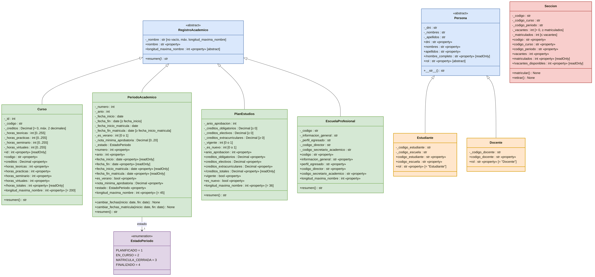

# Caso OTI: sistema académico en Python con POO

Modelo de clases que **impide** los errores que la OTI encontró en su base de datos: secciones con más matriculados que vacantes, periodos que terminan antes de empezar y planes cuyo total de créditos no coincide con la suma de sus partes.

Se aplican los cuatro pilares de la programación orientada a objetos: **encapsulamiento, abstracción, herencia y polimorfismo**.

## Estructura del proyecto

```
caso-oti/
├── main.py                         # Demostración del polimorfismo
├── oti/                            # Paquete principal
│   ├── base/
│   │   ├── registro_academico.py   # Clase abstracta RegistroAcademico
│   │   └── validaciones.py         # Funciones de validación reutilizables
│   ├── enums/
│   │   └── estado_periodo.py       # Enum EstadoPeriodo (1 a 4)
│   ├── registros/
│   │   ├── curso.py
│   │   ├── plan_estudios.py
│   │   ├── escuela_profesional.py
│   │   └── periodo_academico.py
│   ├── matricula/
│   │   └── seccion.py
│   └── personas/
│       ├── persona.py              # Clase abstracta Persona
│       ├── estudiante.py
│       └── docente.py
├── pruebas/
│   └── programa_prueba.py          # Actividad 5: válido aceptado / inválido rechazado
└── docs/
    ├── analisis_del_caso.md        # Trazabilidad: frase del caso → elemento
    ├── actividad_1_ficha.md
    ├── actividad_2_encapsulamiento.md
    ├── actividad_3_abstraccion.md
    ├── actividad_4_herencia.md
    ├── actividad_5_pruebas.md
    ├── salida_programa_prueba.txt
    ├── salida_main.txt
    └── uml/
        ├── README.md               # Diagrama UML (GitHub lo muestra)
        ├── diagrama_clases.drawio  # Diagrama a colores, editable en draw.io
        ├── generar_drawio.py       # Genera el .drawio y el .mmd
        ├── diagrama_clases.mmd     # Fuente Mermaid
        ├── diagrama_clases.png
        └── diagrama_clases.svg
```

## Requisitos

- Python 3.10 o superior. No usa librerías externas.

## Cómo ejecutar

Desde la carpeta raíz del proyecto:

```bash
# Demostración de polimorfismo
python main.py

# Programa de prueba (Actividad 5): 29 reglas, 70 comprobaciones
python -m pruebas.programa_prueba
```

## Actividades

| Actividad | Documento |
|---|---|
| Análisis del caso (frase → elemento) | [docs/analisis_del_caso.md](docs/analisis_del_caso.md) |
| 1. Identificación de clases, atributos y métodos | [docs/actividad_1_ficha.md](docs/actividad_1_ficha.md) |
| 2. Encapsulamiento | [docs/actividad_2_encapsulamiento.md](docs/actividad_2_encapsulamiento.md) |
| 3. Abstracción | [docs/actividad_3_abstraccion.md](docs/actividad_3_abstraccion.md) |
| 4. Herencia y polimorfismo | [docs/actividad_4_herencia.md](docs/actividad_4_herencia.md) |
| 5. Implementación y prueba | [docs/actividad_5_pruebas.md](docs/actividad_5_pruebas.md) |
| Diagrama de clases UML | [docs/uml/README.md](docs/uml/README.md) |

## Diagrama de clases



## Ejemplo de uso

```python
from oti import Seccion

seccion = Seccion("IS282-A", "IS-282", "2026-II", vacantes=2)
seccion.matricular()
seccion.matricular()
print(seccion.vacantes_disponibles)   # 0

seccion.matricular()                  # ValueError: La sección IS282-A está llena
seccion.matriculados = 40             # AttributeError: no tiene setter
```
