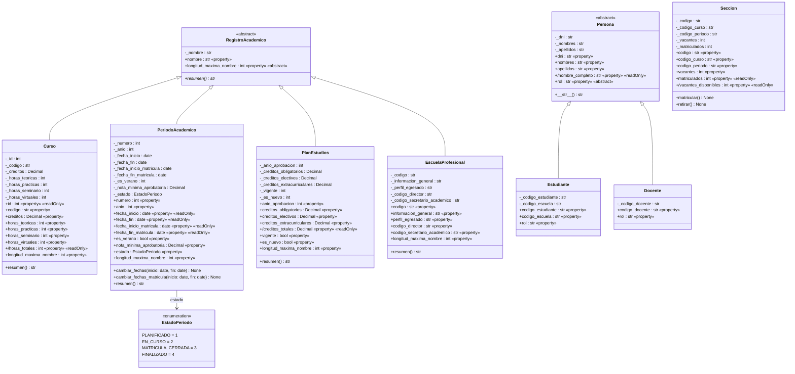

# Diagrama de clases UML

## Convenciones

| Símbolo | Significado |
|---|---|
| `-` | Atributo privado (en Python, prefijo `_`) |
| `+` | Miembro público |
| `«property»` | Propiedad (`@property`) |
| `{readOnly}` / `«readOnly»` | Propiedad sin setter |
| `/nombre` | Atributo derivado: se calcula, no se guarda |
| *cursiva* / `{abstract}` | Método o propiedad abstracta (`@abstractmethod`) |
| `«abstract»` | Clase abstracta: no se puede instanciar |
| flecha con triángulo | Herencia («es un») |

El archivo editable para draw.io es [`diagrama_clases.drawio`](diagrama_clases.drawio) (ábrelo en app.diagrams.net). Las referencias entre registros (sección → curso, escuela → director, etc.) son atributos `str` por la restricción del encargo, por eso no se dibujan como flechas.

## Código fuente del diagrama (GitHub lo dibuja automáticamente)

