# Diagrama de clases UML

## Archivo editable

[`diagrama_clases.drawio`](diagrama_clases.drawio): ábrelo en [app.diagrams.net](https://app.diagrams.net) (Archivo → Abrir desde → Dispositivo). Se regenera con `python docs/uml/generar_drawio.py`.

## Colores

| Color | Significado |
|---|---|
| Azul | Clase abstracta (`RegistroAcademico`, `Persona`) |
| Verde | Subclase de `RegistroAcademico` |
| Naranja | Subclase de `Persona` |
| Rojo | Clase sin herencia (`Seccion`) |
| Morado | Enumeración (`EstadoPeriodo`) |

## Notación

Cada clase tiene tres compartimentos: **atributos privados**, **propiedades** (fondo tenue) y **métodos**.

| Símbolo | Significado |
|---|---|
| `-` | Atributo privado (en Python, prefijo `_`) |
| `+` | Miembro público |
| `«property»` | Propiedad (`@property`) |
| `{readOnly}` | Propiedad sin setter |
| `/nombre` | Atributo derivado: se calcula, no se guarda |
| `{ … }` | Restricción indicada en el caso (por ejemplo `{0..255}`) |
| rojo en cursiva / `{abstract}` | Miembro abstracto (`@abstractmethod`) |
| triángulo hueco | Herencia («es un») |

Por la restricción del encargo («por ahora se guarda solo el código como texto»), las referencias entre registros son atributos `str` y no se dibujan como asociaciones.

## Código fuente del diagrama (GitHub lo dibuja automáticamente)

```mermaid
classDiagram
    direction TB

    class RegistroAcademico {
        <<abstract>>
        -_nombre : str [no vacío, máx. longitud_maxima_nombre]
        +nombre : str «property»
        +longitud_maxima_nombre : int «property» [abstract]
        +resumen()* str
    }

    class Curso {
        -_id : int
        -_codigo : str
        -_creditos : Decimal [> 0, máx. 2 decimales]
        -_horas_teoricas : int [0..255]
        -_horas_practicas : int [0..255]
        -_horas_seminario : int [0..255]
        -_horas_virtuales : int [0..255]
        +id : int «property» [readOnly]
        +codigo : str «property»
        +creditos : Decimal «property»
        +horas_teoricas : int «property»
        +horas_practicas : int «property»
        +horas_seminario : int «property»
        +horas_virtuales : int «property»
        +/horas_totales : int «property» [readOnly]
        +longitud_maxima_nombre : int «property» [= 200]
        +resumen() str
    }

    class PeriodoAcademico {
        -_numero : int
        -_anio : int
        -_fecha_inicio : date
        -_fecha_fin : date [≥ fecha_inicio]
        -_fecha_inicio_matricula : date
        -_fecha_fin_matricula : date [≥ fecha_inicio_matricula]
        -_es_verano : int [0 o 1]
        -_nota_minima_aprobatoria : Decimal [0..20]
        -_estado : EstadoPeriodo
        +numero : int «property»
        +anio : int «property»
        +fecha_inicio : date «property» [readOnly]
        +fecha_fin : date «property» [readOnly]
        +fecha_inicio_matricula : date «property» [readOnly]
        +fecha_fin_matricula : date «property» [readOnly]
        +es_verano : bool «property»
        +nota_minima_aprobatoria : Decimal «property»
        +estado : EstadoPeriodo «property»
        +longitud_maxima_nombre : int «property» [= 45]
        +cambiar_fechas(inicio: date, fin: date) None
        +cambiar_fechas_matricula(inicio: date, fin: date) None
        +resumen() str
    }

    class PlanEstudios {
        -_anio_aprobacion : int
        -_creditos_obligatorios : Decimal [≥ 0]
        -_creditos_electivos : Decimal [≥ 0]
        -_creditos_extracurriculares : Decimal [≥ 0]
        -_vigente : int [0 o 1]
        -_es_nuevo : int [0 o 1]
        +anio_aprobacion : int «property»
        +creditos_obligatorios : Decimal «property»
        +creditos_electivos : Decimal «property»
        +creditos_extracurriculares : Decimal «property»
        +/creditos_totales : Decimal «property» [readOnly]
        +vigente : bool «property»
        +es_nuevo : bool «property»
        +longitud_maxima_nombre : int «property» [= 36]
        +resumen() str
    }

    class EscuelaProfesional {
        -_codigo : str
        -_informacion_general : str
        -_perfil_egresado : str
        -_codigo_director : str
        -_codigo_secretario_academico : str
        +codigo : str «property»
        +informacion_general : str «property»
        +perfil_egresado : str «property»
        +codigo_director : str «property»
        +codigo_secretario_academico : str «property»
        +longitud_maxima_nombre : int «property»
        +resumen() str
    }

    class Persona {
        <<abstract>>
        -_dni : str
        -_nombres : str
        -_apellidos : str
        +dni : str «property»
        +nombres : str «property»
        +apellidos : str «property»
        +/nombre_completo : str «property» [readOnly]
        +rol : str «property» [abstract]
        +#95;#95;str#95;#95;() str
    }

    class Estudiante {
        -_codigo_estudiante : str
        -_codigo_escuela : str
        +codigo_estudiante : str «property»
        +codigo_escuela : str «property»
        +rol : str «property» [= "Estudiante"]
    }

    class Docente {
        -_codigo_docente : str
        +codigo_docente : str «property»
        +rol : str «property» [= "Docente"]
    }

    class Seccion {
        -_codigo : str
        -_codigo_curso : str
        -_codigo_periodo : str
        -_vacantes : int [> 0, ≥ matriculados]
        -_matriculados : int [≤ vacantes]
        +codigo : str «property»
        +codigo_curso : str «property»
        +codigo_periodo : str «property»
        +vacantes : int «property»
        +matriculados : int «property» [readOnly]
        +/vacantes_disponibles : int «property» [readOnly]
        +matricular() None
        +retirar() None
    }

    class EstadoPeriodo {
        <<enumeration>>
        PLANIFICADO = 1
        EN_CURSO = 2
        MATRICULA_CERRADA = 3
        FINALIZADO = 4
    }

    RegistroAcademico <|-- Curso
    RegistroAcademico <|-- PeriodoAcademico
    RegistroAcademico <|-- PlanEstudios
    RegistroAcademico <|-- EscuelaProfesional
    Persona <|-- Estudiante
    Persona <|-- Docente
    PeriodoAcademico --> "1" EstadoPeriodo : estado

    style RegistroAcademico fill:#DAE8FC,stroke:#6C8EBF,stroke-width:2px
    style Curso fill:#D5E8D4,stroke:#82B366,stroke-width:2px
    style PeriodoAcademico fill:#D5E8D4,stroke:#82B366,stroke-width:2px
    style PlanEstudios fill:#D5E8D4,stroke:#82B366,stroke-width:2px
    style EscuelaProfesional fill:#D5E8D4,stroke:#82B366,stroke-width:2px
    style Persona fill:#DAE8FC,stroke:#6C8EBF,stroke-width:2px
    style Estudiante fill:#FFE6CC,stroke:#D79B00,stroke-width:2px
    style Docente fill:#FFE6CC,stroke:#D79B00,stroke-width:2px
    style Seccion fill:#F8CECC,stroke:#B85450,stroke-width:2px
    style EstadoPeriodo fill:#E1D5E7,stroke:#9673A6,stroke-width:2px
```

