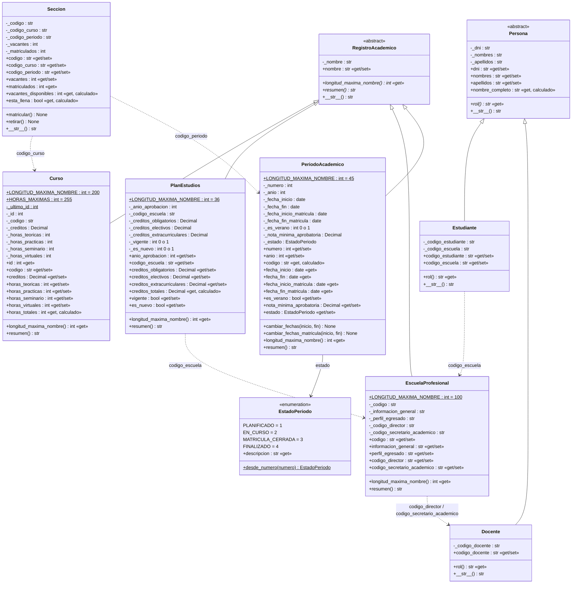

# Diagrama de clases UML

## Convenciones

| Símbolo | Significado |
|---|---|
| `-` | Atributo privado (en Python, prefijo `_`) |
| `+` | Miembro público |
| `«get»` | Propiedad de solo lectura (`@property` sin setter) |
| `«get/set»` | Propiedad con setter que valida |
| `«get, calculado»` | Propiedad calculada: no se guarda |
| *cursiva* | Método o propiedad abstracta (`@abstractmethod`) |
| subrayado | Miembro de clase (estático) |
| `«abstract»` | Clase abstracta: no se puede instanciar |
| flecha con triángulo | Herencia («es un») |
| flecha punteada | Referencia solo por código (texto), según la restricción del encargo |

## Código fuente del diagrama (GitHub lo dibuja automáticamente)

